<div align="center">

# QueueFlow

**Issue tracking and project management for small software teams.**

Isolated workspaces, projects with keyed tickets, a drag-and-drop Kanban board, labels, comments,<br>
an automatic activity history and role-based member management, in English and Spanish.

[](https://github.com/milionhub/QueueFlow/releases/latest)
[](https://github.com/milionhub/QueueFlow/actions/workflows/ci.yml)
[](LICENSE)
<br>


[Demo](#demo) · [Features](#features) · [Screenshots](#screenshots) · [Architecture](#architecture) · [Getting started](#getting-started) · [Quality](#quality-and-testing) · [Deployment](#deployment)

</div>

<p align="center">
  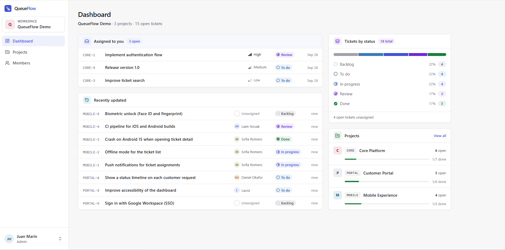
</p>

QueueFlow is a full-stack portfolio project built as a production-style application: a React + TypeScript single-page app on top of a stateless Spring Boot REST API and PostgreSQL. Every team works in its own **workspace** and only ever sees its own data. A workspace contains **projects** identified by a short key such as `CORE`, and each project contains numbered **tickets** (`CORE-1`, `CORE-2`, …).

> **Status:** v1.0.0 is complete. The V1 scope described below is implemented and covered by CI. QueueFlow runs locally (development mode or a production-style Docker stack); **there is no public deployment** - see [Deployment](#deployment).

---

## Demo

<p align="center">
  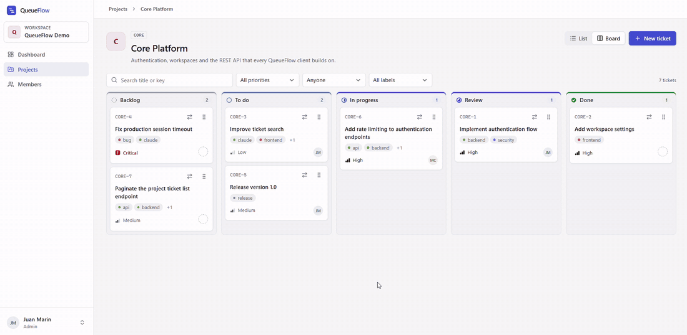
</p>

On the Core Platform board, `CORE-5` is dragged from **To do** to **In progress**. The target column is highlighted while dragging, the counters update on drop, and the backend records the move in the ticket's activity history, exactly like a status change made from the ticket page.

There is no hosted demo. To try QueueFlow, [run it locally](#getting-started) - the Docker stack needs only Docker and a `.env` file. The screenshots and the animation come from a local instance populated with fictional demo data.

## Features

**Workspaces and access**
- Sign up creates a workspace, its first user (the ADMIN) and a starter catalog of 12 labels in one transaction.
- JWT authentication (HS256, 1-hour tokens); role and workspace are re-read from the database on every request, so removing a member takes effect immediately.
- Strict workspace isolation: anything outside your workspace answers `404`, exactly like something that does not exist.
- Role-based permissions (ADMIN / MEMBER), enforced by the backend and mirrored by the UI.

**Projects and tickets**
- Projects with a unique, immutable key (2-10 characters `A-Z`/`0-9`).
- Tickets with title, description, five statuses (`BACKLOG`, `TODO`, `IN_PROGRESS`, `REVIEW`, `DONE`), four priorities (`LOW`-`CRITICAL`), an optional assignee and labels.
- Concurrency-safe per-project numbering (`CORE-7`), backed by a row lock and a unique constraint.
- Inline editing of every field on the ticket page.

**Board and list views**
- Kanban board with one column per status; cards move by drag and drop (mouse, touch or keyboard) or with a "Move" menu.
- Ticket list with search by title or key and filters by status, priority, assignee and label. Filters live in the URL, so they survive reloads and can be shared.

**Collaboration**
- Plain-text comments; only the author can edit or delete their own.
- Automatic, read-only activity history: creation and every change of title, description, status, priority, assignee and labels.
- Dashboard: tickets by status, open tickets assigned to you, recently updated tickets and per-project progress, served by a single request.
- Member management for the ADMIN: add (name, email, initial password), rename and remove members.

**Interface**
- Responsive layout, from a desktop sidebar to a mobile navigation drawer.
- Complete English and Spanish localization, switchable at any time.

### Permissions

Each workspace has exactly one **ADMIN** (whoever registered it) and any number of **MEMBERs** added by the ADMIN. Roles cannot be changed in V1. Outside administration, both roles collaborate on equal terms.

| Capability | ADMIN | MEMBER |
|---|:---:|:---:|
| View the dashboard, projects and tickets | ✅ | ✅ |
| Create projects; edit their name and description | ✅ | ❌ |
| Create tickets; edit title, description, status, priority and assignee | ✅ | ✅ |
| Move tickets on the board | ✅ | ✅ |
| Create labels; add and remove them on tickets | ✅ | ✅ |
| Comment on tickets | ✅ | ✅ |
| Edit or delete a comment | Own only | Own only |
| View the member list (name, email, role) | ✅ | ✅ |
| Add, rename and remove members | ✅ | ❌ |

Details verified in the code:

- **Dashboard** (`/app`): one request, `GET /api/workspaces/{id}/dashboard`.
- **Ticket list** (`/app/projects/CORE`): query parameters `?q=&status=&priority=&assignee=&label=`. Filtering runs in the browser over the project's full ticket list (the backend does not paginate it).
- **Board** (`/app/projects/CORE/board`): the same filters except status, since the columns are the statuses.
- **Ticket page** (`/app/projects/CORE/tickets/7`): inline editing, labels, comments and activity.
- **Projects** cannot be deleted, and their key cannot be changed.
- **Members** (`/app/members`): a new member is created immediately as MEMBER and can sign in right away. QueueFlow sends no email; the ADMIN shares the credentials. The ADMIN cannot remove themselves or another ADMIN.
- **Removing a member**: they can no longer sign in, any token they hold stops working on its next request, their assigned tickets become unassigned (with an activity entry), and the tickets, comments and activity they created are kept.
- **Starter labels**: `frontend`, `backend`, `bug`, `feature`, `enhancement`, `documentation`, `testing`, `security`, `performance`, `ux`, `infrastructure`, `release`.

## Screenshots

<table>
  <tr>
    <td width="50%" valign="top">
      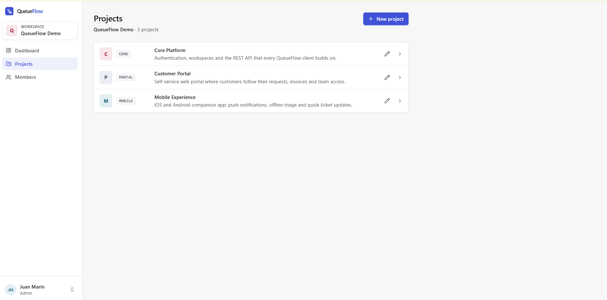
      <p align="center"><sub><b>Projects</b> - each with a short, unique key</sub></p>
    </td>
    <td width="50%" valign="top">
      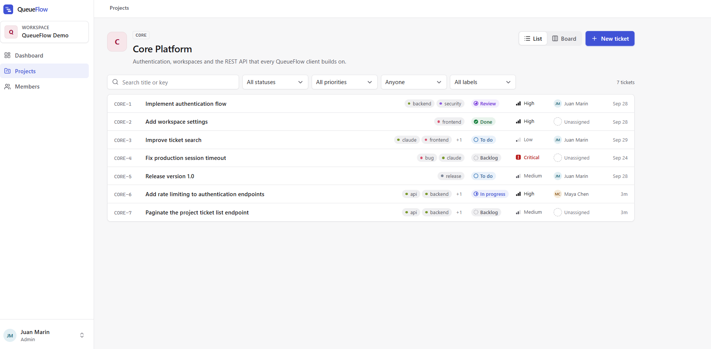
      <p align="center"><sub><b>Ticket list</b> - search and URL-backed filters</sub></p>
    </td>
  </tr>
  <tr>
    <td width="50%" valign="top">
      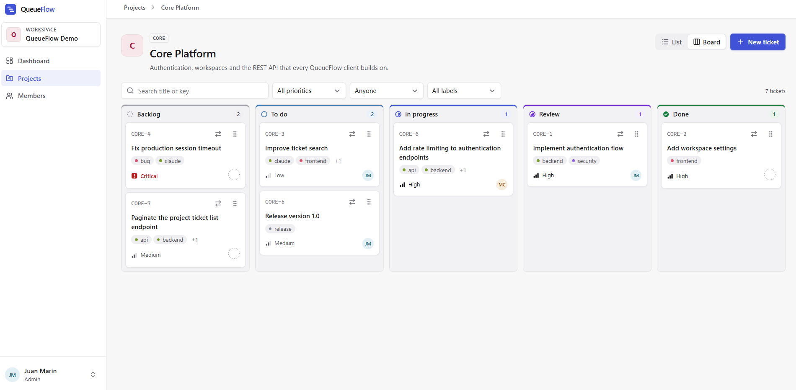
      <p align="center"><sub><b>Kanban board</b> - one column per status</sub></p>
    </td>
    <td width="50%" valign="top">
      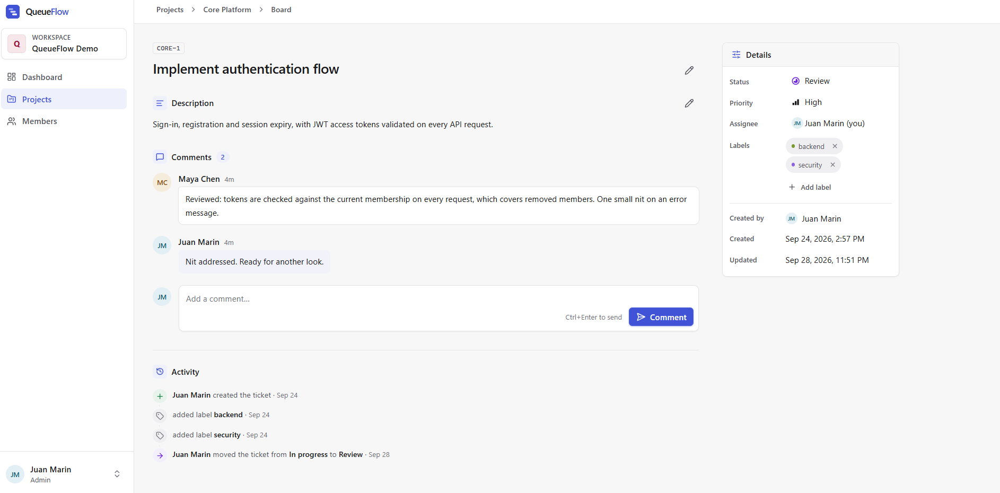
      <p align="center"><sub><b>Ticket details</b> - comments, activity and inline editing</sub></p>
    </td>
  </tr>
  <tr>
    <td width="50%" valign="top">
      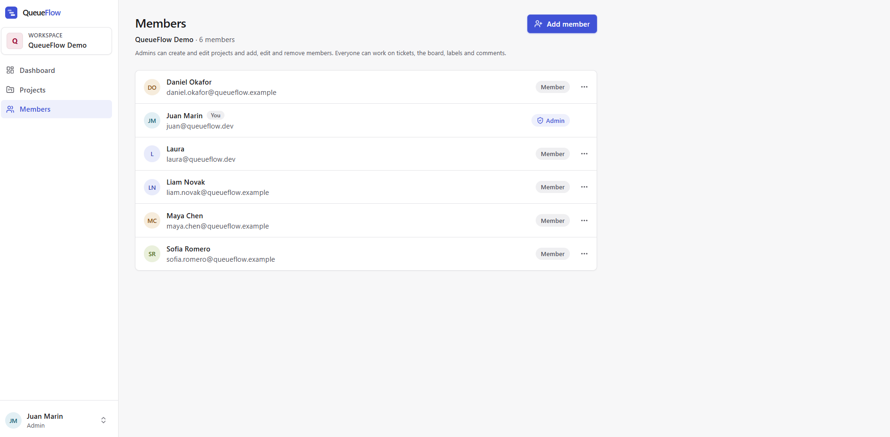
      <p align="center"><sub><b>Members</b> - managed by the workspace ADMIN</sub></p>
    </td>
    <td width="50%" valign="top">
      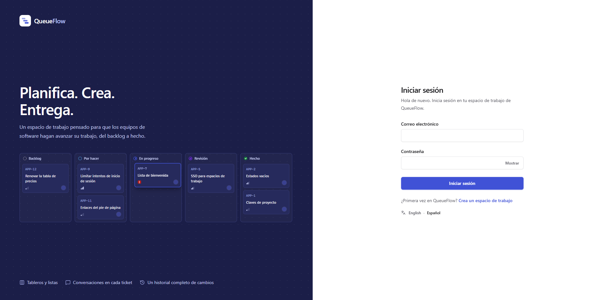
      <p align="center"><sub><b>Sign in</b> - shown with the Spanish locale</sub></p>
    </td>
  </tr>
</table>

<p align="center">
  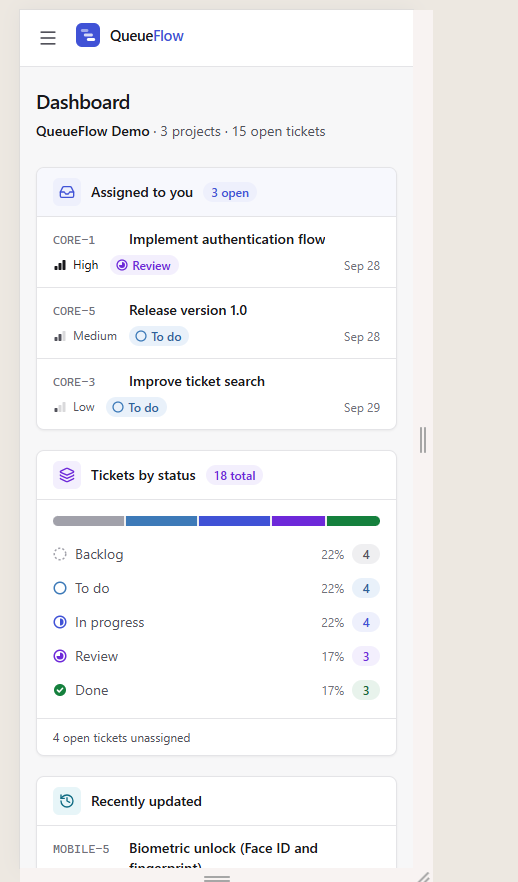
  &nbsp;&nbsp;
  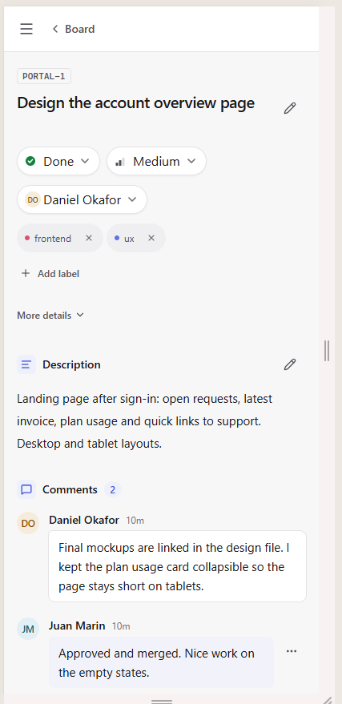
  <br>
  <sub><b>Mobile</b> - dashboard and ticket page on a narrow viewport</sub>
</p>

## Tech stack

Versions taken from `backend/pom.xml`, `frontend/package-lock.json`, the Dockerfiles and the Compose files.

| Area | Technology |
|---|---|
| **Frontend** | React 19, TypeScript 6, Vite 8, Tailwind CSS 4, React Router 8, i18next + react-i18next, dnd-kit (drag and drop), lucide-react (icons) |
| **Backend** | Java 21, Spring Boot 4.1.1 (Web MVC, Data JPA/Hibernate, Validation, Security, OAuth2 Resource Server for JWT, Actuator), springdoc-openapi 3.1.0 |
| **Database** | PostgreSQL 18, schema managed by Flyway |
| **Infrastructure** | Docker, Docker Compose v2, nginx (`nginxinc/nginx-unprivileged:1.28-alpine`), Caddy 2.11 for the prepared HTTPS deployment |
| **Tooling** | Maven 3.9.16 via the Maven Wrapper, npm, oxlint, `tsc -b`, JUnit 5 + Spring Boot Test + MockMvc, GitHub Actions |

## Architecture

QueueFlow is a modular monolith: a React SPA talks to a stateless JSON REST API in Spring Boot, which persists to PostgreSQL. In the production-style Docker stack, the browser only ever sees one origin:

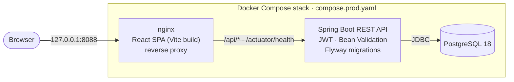

- **nginx** serves the static build and proxies `/api/` and `/actuator/health` to the backend over the stack's private network. It is the only container with a published port, bound to `127.0.0.1`. Swagger UI is deliberately not proxied.
- **Backend and PostgreSQL** publish no host ports. The backend waits for a healthy database, and nginx waits for a healthy backend.
- **Flyway** applies the migrations at startup; Hibernate only **validates** the schema (`ddl-auto: validate`).
- For the prepared public deployment, [`compose.oci.yaml`](compose.oci.yaml) adds **Caddy** in front of nginx for automatic HTTPS (see [Deployment](#deployment)).

In **development** there are two origins, with CORS:

```text
Browser ──► Vite dev server (localhost:5173)     React with hot reload
Browser ──► Spring Boot (localhost:8080) ──► PostgreSQL in Docker (localhost:5432)
```

### Request lifecycle

Example: changing a ticket's status.

1. The frontend sends `PATCH /api/tickets/{ticketId}` with `Authorization: Bearer <token>` (in Docker through nginx, which adds the `X-Forwarded-*` headers).
2. Spring Security validates the JWT (HS256 signature, issuer, expiry). `CurrentUserJwtAuthenticationConverter` loads the user from the `sub` claim, with their current workspace and role. A missing or removed user gets `401`.
3. The controller validates the body (Bean Validation) and calls the service with the `AuthenticatedUser`.
4. Inside one transaction, the service looks the ticket up **within the user's workspace** (otherwise `404`), applies the business rules and records one activity entry per changed field.
5. A JSON DTO is returned. Every error uses one format (`ApiErrorResponse`), produced by `GlobalExceptionHandler`.

### Backend organization

The backend is organized **by feature**, not by technical layer: each package (`ticket`, `project`, `comment`, …) holds its JPA entity, repository, service, controllers and DTOs. Services are the trust boundary - workspace isolation and role checks are decided there.

<details>
<summary><b>Repository structure</b></summary>

```text
QueueFlow/
├── .github/workflows/ci.yml     # CI: backend and frontend jobs
├── .env.example                 # Environment template (copy to .env)
├── compose.yaml                 # PostgreSQL only, for local development
├── compose.prod.yaml            # Full stack: PostgreSQL + backend + frontend/nginx
├── compose.oci.yaml             # Public-VM override: Caddy (HTTPS), limits, log rotation
├── dev.ps1                      # Starts the development environment on Windows
├── deploy/oci/                  # Caddyfile and PostgreSQL backup script
├── docs/
│   ├── assets/                  # README screenshots and demo animation
│   └── deployment-oci.md        # Oracle Cloud deployment guide (Spanish)
├── backend/
│   ├── Dockerfile               # Multi-stage build (JDK → JRE, non-root user)
│   ├── pom.xml, mvnw, mvnw.cmd  # Maven Wrapper
│   └── src/
│       ├── main/java/com/queueflow/
│       │   ├── activity/        # Ticket activity history
│       │   ├── auth/            # Register, login, /me
│       │   ├── comment/         # Comments
│       │   ├── common/          # Exceptions, global error handler, PatchField
│       │   ├── config/          # Security, CORS, OpenAPI, MVC
│       │   ├── dashboard/       # Workspace summary
│       │   ├── label/           # Labels and their ticket association
│       │   ├── project/         # Projects
│       │   ├── security/        # JWT, passwords, authenticated user, RoleAccess
│       │   ├── ticket/          # Tickets, statuses, priorities, numbering
│       │   ├── user/            # Users and member management
│       │   └── workspace/       # Workspaces and WorkspaceAccess
│       ├── main/resources/
│       │   ├── application.yml
│       │   └── db/migration/    # Flyway migrations V1–V6
│       └── test/                # JUnit tests (unit, controller, repository, integration)
└── frontend/
    ├── Dockerfile               # Node 24 build → unprivileged nginx
    ├── docker/                  # nginx.conf and header snippets (proxy, security)
    ├── package.json, package-lock.json, vite.config.ts, .oxlintrc.json
    └── src/
        ├── api/                 # HTTP client and one function per endpoint
        ├── components/          # Shared UI components and app layout
        ├── features/            # auth, board, dashboard, members, projects, tickets, workspace
        ├── i18n/                # i18next setup and en/es texts
        ├── layouts/, pages/     # Root layouts and standalone pages (health, 404, error)
        ├── routes/              # Router and path builders
        ├── hooks/, lib/         # Utilities
        └── styles/              # Global CSS (Tailwind)
```

</details>

<details>
<summary><b>Data model and migrations</b></summary>

The schema is defined **only by Flyway** (`backend/src/main/resources/db/migration`); Hibernate validates it at startup.

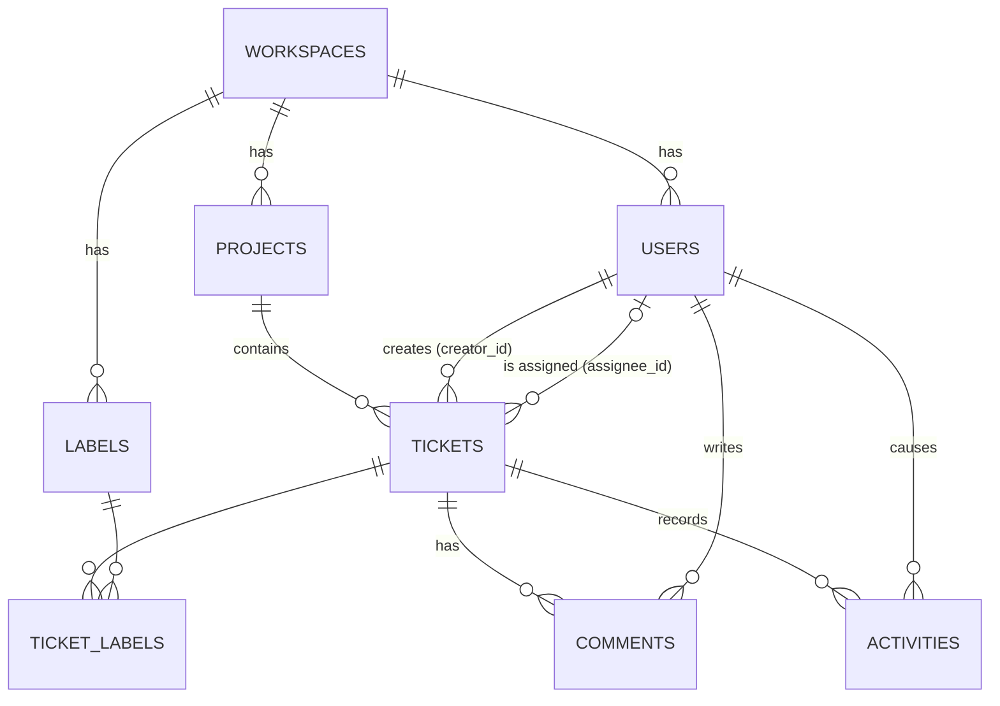

| Table | Contents and notable constraints |
|---|---|
| `workspaces` | Workspace name. |
| `users` | Name, email, password hash, role (`ADMIN`/`MEMBER`), workspace and `removed_at` (soft removal). Case-insensitive unique email (unique index on `lower(email)`). |
| `projects` | Name, key, description and `next_ticket_number` (ticket numbering counter). Key unique per workspace. |
| `tickets` | Number, title, description, status, priority, project, creator and optional assignee. `(project_id, ticket_number)` unique. |
| `labels` | Name (max. 50), unique per workspace. |
| `ticket_labels` | Ticket–label many-to-many (composite primary key). |
| `comments` | Content, ticket and author. |
| `activities` | Event type, old and new value, ticket and user. Insert-only (no `updated_at`). |

Conventions: UUID primary keys generated by PostgreSQL 18 with `uuidv7()` (time-ordered, they do not reveal row counts and do not fragment indexes the way UUIDv4 does), `TIMESTAMPTZ` timestamps, and explicit indexes only where a real query pattern needs them (each justified in its migration).

| Migration | Change |
|---|---|
| `V1` | `workspaces` and `users` |
| `V2` | `projects` |
| `V3` | `tickets` and the `next_ticket_number` counter |
| `V4` | `labels`, `ticket_labels`, `comments`, `activities` |
| `V5` | Case-insensitive email uniqueness |
| `V6` | `users.removed_at` (member removal) |

</details>

<details>
<summary><b>Tickets: statuses, numbering, comments and activity</b></summary>

**Statuses:** `BACKLOG` → `TODO` → `IN_PROGRESS` → `REVIEW` → `DONE`. No transition workflow is enforced: any status can move to any other. In filters, "open" means everything except `DONE`.

**Priorities:** `LOW`, `MEDIUM`, `HIGH`, `CRITICAL`.

Creating a ticket requires project, title (max. 255), status and priority; description and assignee are optional. The assignee must be an active member of the same workspace.

**Concurrency-safe numbering.** The visible key (`CORE-7`) is not stored; it is composed on read from the project key and `ticket_number`. Numbers are **not** assigned with `MAX(ticket_number) + 1`, which breaks under concurrent inserts. Each project has a `next_ticket_number` counter, and the service:

1. locks the project row (`SELECT … FOR UPDATE`, pessimistic lock),
2. takes the number and increments the counter in the same transaction,
3. inserts the ticket.

The `UNIQUE (project_id, ticket_number)` constraint is the safety net, and an integration test creates tickets in parallel to prove it.

**Comments:** plain text, ordered by date. Any member can comment; only the author can edit or delete.

**Activity:** recorded automatically by the backend, in the same transaction as the change: ticket creation and every change of title, description, status, priority, assignee and labels (`TICKET_CREATED`, `TITLE_CHANGED`, `DESCRIPTION_CHANGED`, `STATUS_CHANGED`, `PRIORITY_CHANGED`, `ASSIGNEE_CHANGED`, `LABEL_ADDED`, `LABEL_REMOVED`). Board moves produce the same activity as a status change. Shown oldest first; it cannot be edited.

**Labels:** belong to the workspace and are shared by all its projects. Any member can create and assign them; in V1 they cannot be renamed or deleted.

</details>

### Security

**Authentication (JWT)**
- `POST /api/auth/register` creates a workspace, its starter labels and its first user (ADMIN) in one transaction and returns a token; `POST /api/auth/login` returns a token for valid credentials.
- Tokens are **HS256 JWTs** signed with `JWT_SECRET` (a Base64 key of at least 32 bytes; the backend **refuses to start** without it). They carry only `sub` (user id), `iss` (`queueflow`), `iat` and `exp`, and last **1 hour** (`queueflow.security.jwt.ttl`). The decoder accepts HS256 only, never whatever algorithm the token header claims.
- Every other `/api/**` route requires `Authorization: Bearer <token>`. The API is **stateless** - no session, no cookies - which is why CSRF protection is disabled (there are no credentials the browser attaches automatically).
- **Role and workspace are not in the token**: they are read from the database on every request.
- The frontend keeps the token in `sessionStorage` (survives a reload, gone when the tab closes) and always gets the current user from `GET /api/auth/me`. Signing out only forgets the token in the browser: **there is no server-side logout**.

**Passwords**: at least 8 characters, stored with Spring Security's `DelegatingPasswordEncoder` - currently **BCrypt**, with the algorithm as a prefix (`{bcrypt}…`), so the algorithm could be migrated without invalidating existing hashes. Authentication DTOs redact the password and the token in `toString()`.

**Authorization and isolation** are applied in the **services**, not with controller annotations, in this order:

1. **Isolation** (`WorkspaceAccess` and workspace-scoped queries): every resource is looked up within the user's workspace. A resource from another workspace answers **`404`**, exactly like a non-existent one, so the API never reveals what exists elsewhere.
2. **Role** (`RoleAccess.requireAdmin`): creating/editing projects and adding/editing/removing members require ADMIN, otherwise **`403`**.
3. **Ownership**: only a comment's author can edit or delete it - even against the ADMIN - otherwise **`403`**.

This order guarantees that a MEMBER asking for another workspace's project gets `404`, not `403`.

**Other measures**
- **CORS**: explicit origin list (`QUEUEFLOW_CORS_ALLOWED_ORIGINS`, default `http://localhost:5173`); wildcards are rejected. The Docker stack needs no CORS because everything is same-origin.
- **Proxy headers**: the backend trusts `X-Forwarded-*` only from private addresses (`server.forward-headers-strategy: native`).
- **Containers**: backend and nginx run as non-root users; only the frontend port is published, and only on `127.0.0.1`. nginx adds `X-Content-Type-Options`, `X-Frame-Options` and `Referrer-Policy` headers.
- **Errors** never include stack traces or internal class names.

<details>
<summary><b>REST API</b></summary>

JSON API under `/api`. Every route except register and login requires a token. Identifiers are UUIDs; tickets can also be fetched by number within their project.

| Resource | Endpoints |
|---|---|
| Authentication | `POST /api/auth/register` · `POST /api/auth/login` · `GET /api/auth/me` |
| Workspace | `GET /api/workspaces/{workspaceId}` · `GET /api/workspaces/{workspaceId}/dashboard` |
| Members | `GET`, `POST /api/workspaces/{workspaceId}/members` · `PATCH`, `DELETE /api/workspaces/{workspaceId}/members/{userId}` |
| Users | `GET /api/users/{userId}` · `GET /api/users/by-email?email=` |
| Projects | `GET /api/workspaces/{workspaceId}/projects` · `POST /api/projects` · `GET`, `PATCH /api/projects/{projectId}` · `GET /api/projects/by-key?key=` |
| Tickets | `GET /api/projects/{projectId}/tickets` · `GET /api/projects/{projectId}/tickets/{ticketNumber}` · `POST /api/tickets` · `GET`, `PATCH /api/tickets/{ticketId}` |
| Labels | `GET /api/workspaces/{workspaceId}/labels` · `POST /api/labels` · `GET /api/labels/{labelId}` · `GET /api/labels/by-name?name=` · `PUT`, `DELETE /api/tickets/{ticketId}/labels/{labelId}` |
| Comments | `GET /api/tickets/{ticketId}/comments` · `POST /api/comments` · `GET`, `PATCH`, `DELETE /api/comments/{commentId}` |
| Activity | `GET /api/tickets/{ticketId}/activities` |
| Health | `GET /actuator/health` (public; includes the database check) |

Conventions:

- Creation returns `201 Created` with a `Location` header.
- Updates are partial `PATCH`es: only the fields sent are changed.
- Errors share one body: `{ "timestamp", "status", "error", "message", "path" }`. Codes: `400` (validation or business rule), `401` (missing/invalid token or wrong credentials), `403` (role or ownership), `404` (missing or in another workspace), `405`, `409` (conflict, e.g. duplicate project key or email), `415`.

**OpenAPI.** With the backend running in **development mode**:

- Swagger UI: <http://localhost:8080/swagger-ui.html>
- OpenAPI document: <http://localhost:8080/v3/api-docs> (also `/v3/api-docs.yaml`)

To call protected endpoints, get a token from register or login and use **Authorize** in Swagger UI. In the Docker stack the documentation is not reachable, because nginx does not expose it.

</details>

### Internationalization

The whole interface is available in English and Spanish with i18next. Texts live in `frontend/src/i18n/locales/{en,es}/`, split by area (auth, board, tickets, …), and a shared type (`locales/types.ts`) forces both languages to define the same keys. The language is chosen from the user menu or on the sign-in pages, stored in `localStorage` (`queueflow.language`), and defaults to English. The backend is not translated: its error messages are in English and the frontend shows its own translated texts.

## Getting started

### Prerequisites

- **JDK 21** (Maven is not needed: the wrapper downloads it).
- **Node.js 24** and npm (the version used by the Dockerfile and CI).
- **Docker** with **Docker Compose v2** (Docker Desktop on Windows/macOS).
- Windows PowerShell for the one-command `dev.ps1` script; the manual steps below work on any OS.

### 1. Configure `.env`

Both run modes read a single `.env` file in the repository root:

```bash
cp .env.example .env            # PowerShell: Copy-Item .env.example .env
```

Edit `.env` and set at least `POSTGRES_PASSWORD`, the same value in `DB_PASSWORD`, and your own `JWT_SECRET`, for example from `openssl rand -base64 32`. `.env` is git-ignored: **never commit it**.

### 2a. Production-style Docker stack (quickest)

```bash
docker compose -f compose.prod.yaml up -d --build     # build the images and start
docker compose -f compose.prod.yaml ps                # all three services should become "healthy"
docker compose -f compose.prod.yaml logs -f backend   # follow one service's logs
docker compose -f compose.prod.yaml down              # stop (data is kept)
```

Open <http://localhost:8088> (configurable with `APP_PORT`) and create a workspace.

- The frontend is built with `VITE_API_BASE_URL=/` (same origin), fixed in `compose.prod.yaml`, so the development value from `.env` never ends up in the image.
- The stack uses its own Compose project (`queueflow-stack`) and volume (`queueflow-stack_postgres-data`), separate from the development database (`queueflow-pgdata`). Both modes can run at the same time (no shared ports), and data survives `down` and restarts.

> [!WARNING]
> `docker compose -f compose.prod.yaml down -v` removes the stack **and its volume**, permanently deleting all of the stack's data. The development database is not affected.

### 2b. Development mode

**Windows (PowerShell):**

```powershell
cd frontend
npm install        # first time only, or after dependency changes
cd ..
.\dev.ps1
```

`dev.ps1` does four things:

1. `docker compose up -d`: starts PostgreSQL (`compose.yaml`, port `5432`, volume `queueflow-pgdata`).
2. Loads the variables from `.env` into its process.
3. Opens a PowerShell window with the backend (`.\mvnw.cmd spring-boot:run`, port `8080`); Flyway applies the migrations at startup.
4. Opens another window with the frontend (`npm run dev`, port `5173`).

**macOS / Linux** - the same steps by hand, in two terminals:

```bash
# Terminal 1: database and backend
docker compose up -d
set -a; . ./.env; set +a
cd backend && ./mvnw spring-boot:run

# Terminal 2: frontend (Vite reads VITE_* from the root .env itself)
cd frontend && npm install && npm run dev
```

Open <http://localhost:5173> and create a workspace at `/register`. The `/health` page shows whether the frontend reaches the backend. To stop, close the backend and frontend processes (`Ctrl+C`) and, optionally, `docker compose stop` (the data stays in the volume).

### Environment variables

The full, commented template is [`.env.example`](.env.example). Real values are never committed.

| Variable | Used by | Required | Description |
|---|---|:---:|---|
| `POSTGRES_DB`, `POSTGRES_USER`, `POSTGRES_PASSWORD` | Both modes | Yes | Database, user and password of the PostgreSQL container. The Docker stack also passes them to the backend. |
| `DB_HOST`, `DB_PORT`, `DB_NAME`, `DB_USERNAME`, `DB_PASSWORD` | Development and tests | Yes | How the local backend reaches PostgreSQL; must match `POSTGRES_*`. The Docker stack sets them itself. |
| `JWT_SECRET` | Both modes | Yes | Base64 HS256 key of at least 32 bytes. Neither the backend nor the stack starts without it. |
| `QUEUEFLOW_CORS_ALLOWED_ORIGINS` | Development | No | Comma-separated allowed origins (default `http://localhost:5173`). |
| `VITE_API_BASE_URL` | Frontend in development | Yes (dev) | Backend origin, e.g. `http://localhost:8080`, or `/` for same origin. Fixed into the bundle at build time; only `VITE_*` variables reach the browser. |
| `APP_PORT` | Docker stack | No | Local port of the stack (default `8088`). |
| `QUEUEFLOW_DOMAIN`, `ACME_EMAIL`, `*_MEM_LIMIT` | OCI deployment | Server only | See [`docs/deployment-oci.md`](docs/deployment-oci.md). |

### Running the checks

```bash
# Backend: full suite (needs PostgreSQL and the DB_* variables, see below)
cd backend && ./mvnw verify            # Windows: .\mvnw.cmd verify

# Frontend: lint, type-check and production build
cd frontend && npm ci && npm run lint && npm run build
```

Locally, the backend tests use the database configured in `DB_*` - normally the development database from `compose.yaml`. On Windows, load `.env` into the current PowerShell session first, the same way `dev.ps1` does:

```powershell
Get-Content .env | ForEach-Object { if ($_ -match '^\s*([^#][^=]*)=(.*)$') { [Environment]::SetEnvironmentVariable($matches[1].Trim(), $matches[2].Trim(), 'Process') } }
```

## Quality and testing

**Backend.** The suite (JUnit 5, Spring Boot Test, MockMvc) contains service unit tests, controller tests, repository tests and integration tests against a **real PostgreSQL** (not H2): workspace isolation, role policies, the core end-to-end workflow, concurrent ticket numbering, rollbacks, case-insensitive email uniqueness and the OpenAPI contract. A full `./mvnw verify` of v1.0.0 against an empty PostgreSQL 18 database runs **589 tests with no failures**. Tests use a public, test-only JWT key (`backend/src/test/resources/config/application.yml`); many run in transactions that roll back, and those that need a real commit delete their own data afterwards.

**Frontend.** There are no automated frontend tests yet. Its checks are lint (oxlint) and the type-checked production build (`tsc -b && vite build`).

**Continuous integration.** [`.github/workflows/ci.yml`](.github/workflows/ci.yml) runs on every push to `main`, on pull requests to `main` and on demand, with two **independent** parallel jobs:

| Job | What it does |
|---|---|
| **Backend** | Java 21 (Temurin) with a Maven cache; a disposable PostgreSQL 18 service container; `./mvnw -B -ntp verify` - compilation, Flyway migrations on an empty database, Hibernate schema validation and every test. On failure, the Surefire reports are uploaded as an artifact for 7 days. |
| **Frontend** | Node 24 with an npm cache; `npm ci`, `npm run lint` and `npm run build` with `VITE_API_BASE_URL=/`. |

Any failing command fails its job. No repository secrets are used: the CI database credentials are throwaway values and the JWT key is the public test key. The workflow token is read-only.

**What CI does not cover:** frontend unit or end-to-end tests, building or publishing the Docker images, dependency or coverage scanning, and deployment (there is no CD).

**Schema and runtime safety.** Flyway owns the schema and Hibernate validates it at startup, so a mismatch between entities and migrations stops the application instead of corrupting data. The backend image has a health check on `/actuator/health` (which includes the database), the frontend image checks that nginx serves the app, and Compose starts each service only when its dependency is healthy.

## Deployment

QueueFlow **runs only locally** today: in development mode or with the Docker stack from `compose.prod.yaml`. There is no public instance and no deployment pipeline.

A public deployment on a single Oracle Cloud (OCI) VM is **prepared but not yet performed**: no Always Free ARM capacity was available for the requested VM. The repository already contains:

- [`compose.oci.yaml`](compose.oci.yaml) - an override of the production stack that puts **Caddy** in front of nginx (automatic HTTPS certificates, HTTP→HTTPS redirect, HTTP/3), removes the local port, and adds memory limits and log rotation.
- [`deploy/oci/Caddyfile`](deploy/oci/Caddyfile) and [`deploy/oci/backup.sh`](deploy/oci/backup.sh) - the reverse proxy configuration and a `pg_dump` backup script with retention.
- [`docs/deployment-oci.md`](docs/deployment-oci.md) - a step-by-step guide (in Spanish): network rules, VM setup, configuration, health checks, updates, backup/restore and rollback.

The backup and restore procedure was tested locally; the full guide has not yet been validated on a real VM.

## Design decisions and trade-offs

| Decision | Why | Accepted cost |
|---|---|---|
| Modular monolith organized by feature | Simple to develop, test and deploy at this size | No independent scaling per module |
| Stateless JWT; role and workspace read from the database on each request | No server session state; removals take effect immediately | One extra query per request; no server-side logout or refresh tokens |
| Token in `sessionStorage` | Simple and scoped to the tab | Readable from JavaScript: relies on there being no XSS (no `HttpOnly` cookies) |
| Permissions in services instead of `@PreAuthorize` | Isolation (404) is applied before role (403) | Rules are not visible in controller signatures |
| Other workspace → `404` | Never reveal that foreign data exists | Less explicit responses when debugging |
| Flyway owns the schema + `ddl-auto: validate` | Versioned, reviewable schema; startup fails if entities drift | Every schema change needs a migration |
| UUIDv7 generated by PostgreSQL | Safe identifiers in URLs, time-ordered | Requires PostgreSQL 18 |
| Pessimistic lock for ticket numbering | Correct consecutive numbers under concurrency | Ticket creation within one project is serialized |
| Soft removal of members (`removed_at`) | History (tickets, comments, activity) keeps its real author | Removed users' rows remain |
| Ticket filtering in the browser | Instant results and URL-backed filters | Does not scale to very large projects (no pagination) |
| nginx as the single origin in Docker | No CORS; backend and database expose no ports | One more component in the stack |
| Integration tests on real PostgreSQL | Exercise real constraints, locks and SQL | Tests need a running database |

## Limitations and possible improvements

**Current limitations (V1):**

- No invitations or any email; the ADMIN shares credentials.
- No password change or recovery, no role changes, no member suspension.
- A single ADMIN per workspace, with no transfer of administration.
- No refresh tokens or server-side logout; no rate limiting on login or registration.
- Projects cannot be deleted or re-keyed; labels cannot be renamed or deleted.
- No pagination of a project's ticket list.
- No attachments, notifications or real-time updates.
- No automated frontend tests; the main bundle exceeds 500 kB minified (Vite warns about it).
- The local Docker stack serves plain HTTP on `127.0.0.1` (HTTPS is part of the prepared OCI deployment).

**Possible improvements (not implemented):** a public deployment, frontend and end-to-end tests, refresh tokens and server-side logout, rate limiting on login and registration, email invitations, server-side pagination and code-splitting of the frontend bundle.

<details>
<summary><b>Troubleshooting</b></summary>

| Symptom | Likely cause and fix |
|---|---|
| The backend does not start and mentions `JWT_SECRET` | Missing, or not Base64 of at least 32 bytes. Generate one with `openssl rand -base64 32` and put it in `.env`. |
| `docker compose -f compose.prod.yaml up` fails with "… must be set" | A required variable is missing from `.env` (`POSTGRES_*` or `JWT_SECRET`). |
| `failed to connect to the docker API` | Docker Desktop is not running. |
| The backend cannot reach PostgreSQL in development | PostgreSQL is not running (`docker compose ps`) or `DB_*` does not match `POSTGRES_*`. Another local PostgreSQL may be using port `5432`. |
| PostgreSQL authentication fails after changing `POSTGRES_PASSWORD` | The password only applies when the volume is created. Restore the original password or recreate the volume (this deletes its data). |
| The UI reports an API configuration error | `VITE_API_BASE_URL` is missing or invalid in `.env` (must be an `http(s)` URL or `/`). Restart `npm run dev` after changing it. |
| CORS errors in development | Open the app at `http://localhost:5173` (not `127.0.0.1`) or add your origin to `QUEUEFLOW_CORS_ALLOWED_ORIGINS`. |
| You are sent back to the sign-in page | The token expires after one hour and is lost when the tab closes. Sign in again. |
| The Docker stack never becomes `healthy` | Check `docker compose -f compose.prod.yaml logs backend`; the backend has a 60 s start period to boot and migrate. |
| Port `8088` is already in use | Set another `APP_PORT` in `.env`. |

</details>

## Project status

**v1.0.0** - feature-complete for the V1 scope, with CI passing on `main`. See the [v1.0.0 release](https://github.com/milionhub/QueueFlow/releases/tag/v1.0.0).

## License

Released under the [MIT License](LICENSE).

## Author

**Juan Marín Escolano** - [GitHub @milionhub](https://github.com/milionhub)
