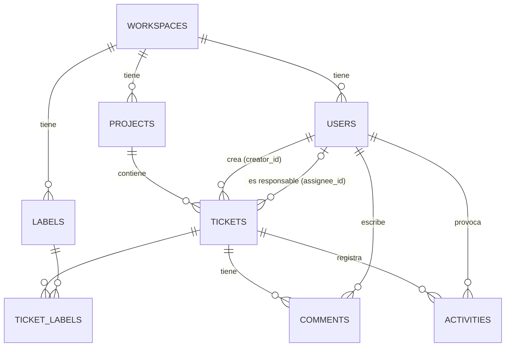

# QueueFlow

Aplicación web de seguimiento de incidencias y gestión de proyectos para equipos de software pequeños: espacios de trabajo aislados, proyectos, tickets con estados y prioridades, tablero kanban, etiquetas, comentarios, historial de actividad y gestión de miembros con roles.

> **Estado:** proyecto de portfolio en desarrollo activo. Funciona en local (modo desarrollo y stack Docker de estilo producción). **No está desplegado públicamente.**

## Índice

1. [Qué es QueueFlow y alcance de la V1](#1-qué-es-queueflow-y-alcance-de-la-v1)
2. [Funcionalidades por rol](#2-funcionalidades-por-rol)
3. [Stack tecnológico](#3-stack-tecnológico)
4. [Arquitectura](#4-arquitectura)
5. [Estructura del repositorio](#5-estructura-del-repositorio)
6. [Modelo de datos](#6-modelo-de-datos)
7. [Seguridad: autenticación, autorización y aislamiento](#7-seguridad-autenticación-autorización-y-aislamiento)
8. [API REST](#8-api-rest)
9. [Tickets: estados, numeración, comentarios y actividad](#9-tickets-estados-numeración-comentarios-y-actividad)
10. [Internacionalización (EN/ES)](#10-internacionalización-enes)
11. [Puesta en marcha](#11-puesta-en-marcha)
12. [Variables de entorno](#12-variables-de-entorno)
13. [Pruebas](#13-pruebas)
14. [Integración continua (GitHub Actions)](#14-integración-continua-github-actions)
15. [Decisiones de diseño y trade-offs](#15-decisiones-de-diseño-y-trade-offs)
16. [Limitaciones actuales y mejoras futuras](#16-limitaciones-actuales-y-mejoras-futuras)
17. [Estado del despliegue](#17-estado-del-despliegue)
18. [Solución de problemas](#18-solución-de-problemas)

---

## 1. Qué es QueueFlow y alcance de la V1

QueueFlow es una aplicación *multi-tenant*: cada equipo trabaja en su propio **espacio de trabajo** (*workspace*) y solo ve sus datos. Dentro de un workspace hay **proyectos** (identificados por una clave corta como `CORE`), y dentro de cada proyecto **tickets** numerados (`CORE-1`, `CORE-2`…).

El alcance de la V1 es deliberadamente acotado:

- Registro de un workspace junto con su primer usuario (ADMIN) e inicio de sesión con JWT.
- Proyectos, tickets, tablero kanban, etiquetas, comentarios e historial de actividad automático.
- Gestión de miembros por parte del ADMIN (alta, renombrado y baja).
- Interfaz completa en inglés y español.
- Ejecución local: modo desarrollo y stack Docker de estilo producción.

Lo que **no** existe todavía (invitaciones por email, cambio de contraseña, *refresh tokens*, despliegue público, etc.) está listado en [Limitaciones](#16-limitaciones-actuales-y-mejoras-futuras).

## 2. Funcionalidades por rol

Cada workspace tiene exactamente un **ADMIN** (quien lo registró) y cualquier número de **MEMBER**, que el ADMIN da de alta. En la V1 no se pueden cambiar roles. Fuera de las operaciones de administración, ambos roles colaboran en igualdad de condiciones.

| Funcionalidad | ADMIN | MEMBER |
|---|:---:|:---:|
| Ver el panel (*dashboard*) del workspace | ✅ | ✅ |
| Ver proyectos y sus tickets | ✅ | ✅ |
| Crear proyectos y editar su nombre y descripción | ✅ | ❌ |
| Crear tickets y editar título, descripción, estado, prioridad y responsable | ✅ | ✅ |
| Mover tickets en el tablero kanban | ✅ | ✅ |
| Añadir y quitar etiquetas de un ticket; crear etiquetas nuevas | ✅ | ✅ |
| Comentar en un ticket | ✅ | ✅ |
| Editar o borrar un comentario | Solo los suyos | Solo los suyos |
| Ver la lista de miembros (nombre, email y rol) | ✅ | ✅ |
| Dar de alta, renombrar y dar de baja miembros | ✅ | ❌ |

Detalles verificados en el código:

- **Panel** (`/app`): tickets por estado, tickets abiertos asignados al usuario, cambios recientes y recuento de tickets por proyecto, todo en una sola petición (`GET /api/workspaces/{id}/dashboard`).
- **Lista de tickets** (`/app/projects/CORE`): búsqueda y filtros por estado, prioridad, responsable y etiqueta. Los filtros viven en la URL (`?q=&status=&priority=&assignee=&label=`), así que sobreviven a recargas y se pueden compartir. El filtrado se hace en el navegador sobre la lista completa del proyecto (el backend no pagina esa lista).
- **Tablero** (`/app/projects/CORE/board`): una columna por estado; un ticket se mueve arrastrándolo (ratón, táctil o teclado) o con su control «Mover». Aplican los mismos filtros, salvo el de estado (las columnas ya son los estados).
- **Detalle de ticket** (`/app/projects/CORE/tickets/7`): edición en línea de todos sus campos, etiquetas, comentarios (texto plano) y actividad.
- **Proyectos**: la clave (2–10 caracteres `A-Z`/`0-9`, normalizada a mayúsculas) es única dentro del workspace y **no se puede cambiar**. Los proyectos **no se pueden borrar**.
- **Miembros** (`/app/members`): el ADMIN introduce nombre, email y contraseña inicial; la cuenta se crea al momento como MEMBER y puede iniciar sesión inmediatamente. QueueFlow no envía emails: el ADMIN comunica las credenciales por su cuenta. El ADMIN no puede darse de baja ni dar de baja a otro ADMIN.
- **Baja de un miembro**: deja de poder iniciar sesión, cualquier token que tuviera deja de funcionar en la siguiente petición, sus tickets asignados pasan a «sin asignar» (con su entrada de actividad) y los tickets, comentarios y actividad que creó se conservan.
- **Etiquetas iniciales**: cada workspace nuevo recibe un catálogo de 12 etiquetas (`frontend`, `backend`, `bug`, `feature`, `enhancement`, `documentation`, `testing`, `security`, `performance`, `ux`, `infrastructure`, `release`).
- La interfaz solo ofrece lo que el rol actual permite, y el backend aplica las mismas reglas de forma independiente.

## 3. Stack tecnológico

Versiones tomadas de `backend/pom.xml`, `frontend/package.json`, los `Dockerfile` y los ficheros Compose.

| Capa | Tecnología |
|---|---|
| Backend | Java 21, Spring Boot 4.1.1 (Web MVC, Data JPA/Hibernate, Validation, Security, OAuth2 Resource Server, Actuator) |
| Build backend | Maven 3.9.16 vía Maven Wrapper (`mvnw` / `mvnw.cmd`) |
| Base de datos | PostgreSQL 18 (imagen `postgres:18-alpine`), migraciones con Flyway |
| Documentación API | springdoc-openapi 3.1.0 (OpenAPI 3 + Swagger UI) |
| Frontend | React 19, TypeScript 6, Vite 8, Tailwind CSS 4, React Router 8 |
| Frontend (otras) | i18next + react-i18next, dnd-kit (arrastrar y soltar), lucide-react (iconos) |
| Calidad frontend | oxlint (lint) y `tsc -b` (comprobación de tipos) |
| Contenedores | Docker + Docker Compose v2; `eclipse-temurin:21` (JDK para compilar, JRE para ejecutar), `node:24-alpine` (build), `nginxinc/nginx-unprivileged:1.28-alpine` (servir frontend) |
| CI | GitHub Actions |

## 4. Arquitectura

QueueFlow es una SPA (*single-page application*) React que habla con una API REST JSON *stateless* en Spring Boot, la cual persiste en PostgreSQL. Hay dos formas de ejecutarla:

**Stack Docker (estilo producción)** — el navegador solo ve un origen:

```text
Navegador ──► nginx (contenedor frontend, 127.0.0.1:8088)
                ├─ /              → ficheros estáticos de la build de Vite (SPA)
                ├─ /api/          → proxy ──► Spring Boot (contenedor backend, :8080, sin puerto en el host)
                └─ /actuator/health → proxy ──► Spring Boot
                                                   │
                                                   ▼
                                     PostgreSQL 18 (contenedor, sin puerto en el host)
```

**Desarrollo local** — dos orígenes, con CORS:

```text
Navegador ──► Vite dev server (localhost:5173)          ← código React con recarga en caliente
Navegador ──► Spring Boot (localhost:8080)  ──► PostgreSQL en Docker (localhost:5432)
```

### Flujo de una petición (ejemplo: cambiar el estado de un ticket)

1. El frontend envía `PATCH /api/tickets/{ticketId}` con `Authorization: Bearer <token>` (en Docker, a través de nginx, que añade las cabeceras `X-Forwarded-*`).
2. Spring Security valida el JWT (firma HS256, emisor y expiración) y `CurrentUserJwtAuthenticationConverter` carga desde la base de datos el usuario del claim `sub`: su workspace y su rol actuales. Si el usuario ya no existe o fue dado de baja → `401`.
3. El controlador valida el cuerpo (Bean Validation) y llama al servicio pasando el `AuthenticatedUser`.
4. El servicio, dentro de una transacción, busca el ticket **en el workspace del usuario** (si no está ahí → `404`), aplica las reglas de negocio y registra una entrada de actividad por cada campo modificado.
5. Se devuelve un DTO JSON. Cualquier error sale en un formato común (`ApiErrorResponse`) desde `GlobalExceptionHandler`.

### Organización del backend

El backend está organizado **por funcionalidad** (no por capa técnica): cada paquete (`ticket`, `project`, `comment`…) contiene su entidad JPA, repositorio, servicio, controladores y DTOs. Los servicios son la frontera de confianza: ahí se deciden el aislamiento por workspace y los permisos por rol.

## 5. Estructura del repositorio

```text
QueueFlow/
├── .github/workflows/ci.yml     # CI: jobs backend y frontend
├── .env.example                 # Plantilla de variables de entorno (copiar a .env)
├── compose.yaml                 # Solo PostgreSQL, para desarrollo local
├── compose.prod.yaml            # Stack completo: PostgreSQL + backend + frontend/nginx
├── dev.ps1                      # Arranque del entorno de desarrollo en Windows
├── backend/
│   ├── Dockerfile               # Build multi-etapa (JDK → JRE, usuario no root)
│   ├── pom.xml, mvnw, mvnw.cmd  # Maven Wrapper
│   └── src/
│       ├── main/java/com/queueflow/
│       │   ├── activity/        # Historial de actividad de tickets
│       │   ├── auth/            # Registro, login, /me
│       │   ├── comment/         # Comentarios
│       │   ├── common/          # Excepciones, manejador global de errores, PatchField
│       │   ├── config/          # Seguridad, CORS, OpenAPI, MVC
│       │   ├── dashboard/       # Resumen del workspace
│       │   ├── label/           # Etiquetas y su asociación con tickets
│       │   ├── project/         # Proyectos
│       │   ├── security/        # JWT, contraseñas, usuario autenticado, RoleAccess
│       │   ├── ticket/          # Tickets, estados, prioridades, numeración
│       │   ├── user/            # Usuarios y gestión de miembros
│       │   └── workspace/       # Workspaces y WorkspaceAccess
│       ├── main/resources/
│       │   ├── application.yml
│       │   └── db/migration/    # Migraciones Flyway V1–V6
│       └── test/                # Tests JUnit (unitarios, de controlador, de repositorio e integración)
└── frontend/
    ├── Dockerfile               # Build con Node 24 → nginx sin privilegios
    ├── docker/                  # nginx.conf y fragmentos de cabeceras (proxy y seguridad)
    ├── package.json, package-lock.json, vite.config.ts, .oxlintrc.json
    └── src/
        ├── api/                 # Cliente HTTP y una función por endpoint
        ├── components/          # Componentes de UI compartidos y layout de la app
        ├── features/            # Por funcionalidad: auth, board, dashboard, members, projects, tickets, workspace
        ├── i18n/                # Configuración de i18next y textos en/es
        ├── layouts/, pages/     # Layouts raíz y páginas sueltas (salud, 404, error)
        ├── routes/              # Router y construcción de rutas
        ├── hooks/, lib/         # Utilidades
        └── styles/              # CSS global (Tailwind)
```

## 6. Modelo de datos

El esquema lo define **exclusivamente Flyway** (`backend/src/main/resources/db/migration`); Hibernate solo lo **valida** al arrancar (`ddl-auto: validate`).



| Tabla | Contenido y restricciones relevantes |
|---|---|
| `workspaces` | Nombre del espacio de trabajo. |
| `users` | Nombre, email, hash de contraseña, rol (`ADMIN`/`MEMBER`), workspace y `removed_at` (baja lógica). Email único sin distinguir mayúsculas (índice único sobre `lower(email)`). |
| `projects` | Nombre, clave, descripción y `next_ticket_number` (contador para numerar tickets). Clave única por workspace. |
| `tickets` | Número, título, descripción, estado, prioridad, proyecto, creador y responsable opcional. `(project_id, ticket_number)` único. |
| `labels` | Nombre (máx. 50), único por workspace. |
| `ticket_labels` | Relación N:M ticket–etiqueta (PK compuesta). |
| `comments` | Contenido, ticket y autor. |
| `activities` | Tipo de evento, valor anterior y nuevo, ticket y usuario. Solo inserción (sin `updated_at`). |

Convenciones: claves primarias UUID generadas por PostgreSQL 18 con `uuidv7()` (ordenadas en el tiempo, no revelan cuántas filas hay y no fragmentan los índices como UUIDv4), timestamps `TIMESTAMPTZ`, índices explícitos solo donde hay un patrón de consulta real (justificados en comentarios de cada migración).

| Migración | Cambio |
|---|---|
| `V1` | `workspaces` y `users` |
| `V2` | `projects` |
| `V3` | `tickets` y contador `next_ticket_number` |
| `V4` | `labels`, `ticket_labels`, `comments`, `activities` |
| `V5` | Unicidad de email sin distinguir mayúsculas |
| `V6` | `users.removed_at` (baja de miembros) |

## 7. Seguridad: autenticación, autorización y aislamiento

### Autenticación (JWT)

- `POST /api/auth/register` crea un workspace, sus etiquetas iniciales y su primer usuario (ADMIN) en una sola transacción, y devuelve un token. `POST /api/auth/login` devuelve un token para credenciales válidas.
- El token es un **JWT HS256** firmado con `JWT_SECRET` (clave Base64 de al menos 32 bytes; el backend **no arranca** sin ella). Contiene solo `sub` (id de usuario), `iss` (`queueflow`), `iat` y `exp`. Duración: **1 hora** (`queueflow.security.jwt.ttl`). El decodificador solo acepta HS256, nunca el algoritmo que diga la cabecera del token.
- Todas las demás rutas `/api/**` exigen `Authorization: Bearer <token>`. La API es **stateless**: sin sesión ni cookies, y por eso CSRF está desactivado (no hay credenciales que el navegador adjunte automáticamente).
- El **rol y el workspace no viajan en el token**: se leen de la base de datos en cada petición. Así, la baja de un miembro surte efecto en su siguiente petición, sin esperar a que caduque el token.
- En el frontend el token se guarda en `sessionStorage` (sobrevive a recargar la pestaña, desaparece al cerrarla) y el usuario actual se obtiene siempre de `GET /api/auth/me`. Cerrar sesión solo olvida el token en el navegador: **no hay logout en servidor**.

### Contraseñas

Mínimo 8 caracteres. Se almacenan con el `DelegatingPasswordEncoder` de Spring Security, que hoy usa **BCrypt** y guarda el algoritmo como prefijo (`{bcrypt}…`), de modo que se podría migrar a otro algoritmo sin invalidar los hashes existentes. Los DTOs de autenticación ocultan la contraseña y el token en su `toString()`.

### Autorización (RBAC) y aislamiento por workspace

Las reglas se aplican en los **servicios**, no con anotaciones en los controladores, y en este orden:

1. **Aislamiento** (`WorkspaceAccess` y consultas filtradas por workspace): todo recurso se busca dentro del workspace del usuario. Un recurso de otro workspace responde **`404`**, exactamente igual que uno inexistente, así que la API no revela qué existe en otros workspaces.
2. **Rol** (`RoleAccess.requireAdmin`): crear/editar proyectos y crear/editar/dar de baja miembros exige ADMIN; si no → **`403`**.
3. **Autoría**: solo el autor de un comentario puede editarlo o borrarlo (también frente al ADMIN) → **`403`**.

Ese orden garantiza que un MEMBER que pregunta por un proyecto de otro workspace reciba `404` y no `403`.

### Otras medidas

- **CORS**: lista explícita de orígenes (`QUEUEFLOW_CORS_ALLOWED_ORIGINS`, por defecto `http://localhost:5173`); los comodines se rechazan. En Docker no hace falta CORS porque todo va por el mismo origen.
- **Proxy**: el backend confía en las cabeceras `X-Forwarded-*` solo si llegan desde direcciones privadas (`server.forward-headers-strategy: native`).
- **Contenedores**: backend y nginx se ejecutan con usuarios no root; solo se publica el puerto del frontend y solo en `127.0.0.1`. Swagger UI no se expone a través de nginx.
- **Errores**: nunca incluyen trazas ni nombres de clases internas.

## 8. API REST

API JSON bajo `/api`. Todas las rutas salvo registro y login requieren token. Los identificadores son UUID; los tickets también se pueden obtener por número dentro de su proyecto.

| Recurso | Endpoints |
|---|---|
| Autenticación | `POST /api/auth/register` · `POST /api/auth/login` · `GET /api/auth/me` |
| Workspace | `GET /api/workspaces/{workspaceId}` · `GET /api/workspaces/{workspaceId}/dashboard` |
| Miembros | `GET`, `POST /api/workspaces/{workspaceId}/members` · `PATCH`, `DELETE /api/workspaces/{workspaceId}/members/{userId}` |
| Usuarios | `GET /api/users/{userId}` · `GET /api/users/by-email?email=` |
| Proyectos | `GET /api/workspaces/{workspaceId}/projects` · `POST /api/projects` · `GET`, `PATCH /api/projects/{projectId}` · `GET /api/projects/by-key?key=` |
| Tickets | `GET /api/projects/{projectId}/tickets` · `GET /api/projects/{projectId}/tickets/{ticketNumber}` · `POST /api/tickets` · `GET`, `PATCH /api/tickets/{ticketId}` |
| Etiquetas | `GET /api/workspaces/{workspaceId}/labels` · `POST /api/labels` · `GET /api/labels/{labelId}` · `GET /api/labels/by-name?name=` · `PUT`, `DELETE /api/tickets/{ticketId}/labels/{labelId}` |
| Comentarios | `GET /api/tickets/{ticketId}/comments` · `POST /api/comments` · `GET`, `PATCH`, `DELETE /api/comments/{commentId}` |
| Actividad | `GET /api/tickets/{ticketId}/activities` |
| Salud | `GET /actuator/health` (público; incluye la comprobación de la base de datos) |

Convenciones:

- Las creaciones responden `201 Created` con cabecera `Location`.
- Las actualizaciones son `PATCH` parciales: solo se modifican los campos enviados.
- Errores con un cuerpo común: `{ "timestamp", "status", "error", "message", "path" }`. Códigos: `400` (validación o regla de negocio), `401` (sin token, token inválido o credenciales incorrectas), `403` (rol o autoría), `404` (no existe o es de otro workspace), `405`, `409` (conflicto, p. ej. clave de proyecto o email duplicados), `415`.

### Documentación OpenAPI

Con el backend en marcha en **modo desarrollo**:

- Swagger UI: <http://localhost:8080/swagger-ui.html>
- Documento OpenAPI: <http://localhost:8080/v3/api-docs> (también `/v3/api-docs.yaml`)

Para probar endpoints protegidos, obtén un token con register o login y pulsa **Authorize** en Swagger UI. En el stack Docker la documentación no es accesible porque nginx no la expone.

## 9. Tickets: estados, numeración, comentarios y actividad

**Estados:** `BACKLOG` → `TODO` → `IN_PROGRESS` → `REVIEW` → `DONE`. No hay un flujo de transiciones impuesto: se puede pasar de cualquier estado a cualquier otro. En los filtros, «abiertos» significa todo salvo `DONE`.

**Prioridades:** `LOW`, `MEDIUM`, `HIGH`, `CRITICAL`.

Al crear un ticket son obligatorios proyecto, título (máx. 255), estado y prioridad; la descripción y el responsable son opcionales. El responsable debe ser un miembro activo del mismo workspace.

**Numeración concurrente segura.** La clave visible (`CORE-7`) no se guarda: se compone al leer a partir de la clave del proyecto y `ticket_number`. Para asignar el número **no** se usa `MAX(ticket_number) + 1` (que falla con inserciones concurrentes); cada proyecto tiene un contador `next_ticket_number` y el servicio:

1. bloquea la fila del proyecto (`SELECT … FOR UPDATE`, bloqueo pesimista),
2. toma el número y lo incrementa en la misma transacción,
3. inserta el ticket.

La restricción `UNIQUE (project_id, ticket_number)` actúa como red de seguridad, y hay un test de integración que crea tickets en paralelo para comprobarlo.

**Comentarios:** texto plano, ordenados por fecha. Cualquier miembro puede comentar; solo el autor puede editar o borrar.

**Actividad:** el backend registra automáticamente, en la misma transacción que el cambio, la creación del ticket y cada cambio de título, descripción, estado, prioridad, responsable y etiquetas (tipos `TICKET_CREATED`, `TITLE_CHANGED`, `DESCRIPTION_CHANGED`, `STATUS_CHANGED`, `PRIORITY_CHANGED`, `ASSIGNEE_CHANGED`, `LABEL_ADDED`, `LABEL_REMOVED`). Los movimientos en el tablero generan la misma actividad que un cambio de estado. Se muestra de la más antigua a la más reciente y no se puede editar.

**Etiquetas:** pertenecen al workspace y se comparten entre todos sus proyectos. Cualquier miembro puede crearlas y asignarlas; en la V1 no se pueden renombrar ni borrar.

## 10. Internacionalización (EN/ES)

Toda la interfaz está disponible en inglés y español con i18next. Los textos están en `frontend/src/i18n/locales/{en,es}/`, separados por área (auth, board, tickets…), y un tipo común (`locales/types.ts`) obliga a que ambos idiomas tengan las mismas claves. El idioma se elige desde el menú de usuario o en las páginas de inicio de sesión, se guarda en `localStorage` (`queueflow.language`) y por defecto es inglés.

El backend no se traduce: sus mensajes de error están en inglés y el frontend muestra sus propios textos traducidos.

## 11. Puesta en marcha

### Requisitos

- Windows con PowerShell (el script de desarrollo `dev.ps1` es PowerShell; el resto de comandos son estándar).
- JDK 21 (Maven no hace falta: lo descarga el wrapper).
- Node.js 24 y npm (la versión usada por el `Dockerfile` y la CI).
- Docker Desktop con Docker Compose v2.

### Configuración (`.env`)

Ambos modos leen un único `.env` en la raíz del repositorio:

```powershell
Copy-Item .env.example .env
```

Edita `.env` y define, como mínimo, `POSTGRES_PASSWORD`, el mismo valor en `DB_PASSWORD` y un `JWT_SECRET` propio, por ejemplo con `openssl rand -base64 32`. `.env` está en `.gitignore`: **no lo subas nunca al repositorio**.

### Modo desarrollo (Windows)

```powershell
cd frontend
npm install        # solo la primera vez o tras cambiar dependencias
cd ..
.\dev.ps1
```

`dev.ps1` hace cuatro cosas:

1. `docker compose up -d`: arranca PostgreSQL (`compose.yaml`, puerto `5432`, volumen `queueflow-pgdata`).
2. Carga las variables de `.env` en su proceso.
3. Abre una ventana de PowerShell con el backend (`.\mvnw.cmd spring-boot:run`, puerto `8080`). Flyway aplica las migraciones al arrancar.
4. Abre otra ventana con el frontend (`npm run dev`, puerto `5173`).

Abre <http://localhost:5173> y crea un workspace en `/register`. La ruta `/health` muestra si el frontend llega al backend.

Para detenerlo: cierra las dos ventanas (o `Ctrl+C` en cada una) y, si quieres parar la base de datos, `docker compose stop` (los datos se conservan en el volumen).

### Stack Docker de estilo producción

```powershell
docker compose -f compose.prod.yaml up -d --build     # construir imágenes y arrancar
docker compose -f compose.prod.yaml ps                # los tres servicios deben llegar a "healthy"
docker compose -f compose.prod.yaml logs -f backend   # seguir los logs de un servicio
docker compose -f compose.prod.yaml down              # detener (los datos se conservan)
```

Abre <http://localhost:8088> (configurable con `APP_PORT`) y crea un workspace.

- Solo el contenedor `frontend` publica un puerto, y solo en `127.0.0.1`. Backend y PostgreSQL no son accesibles desde el host.
- El backend espera a que PostgreSQL esté sano, y nginx espera a que el backend esté sano.
- El frontend se construye con `VITE_API_BASE_URL=/` (mismo origen), fijado en `compose.prod.yaml`, así que el valor de desarrollo de `.env` nunca acaba en la imagen.

**Persistencia y volúmenes.** El stack usa su propio proyecto Compose (`queueflow-stack`) y su propio volumen (`queueflow-stack_postgres-data`), independiente de la base de datos de desarrollo (`queueflow-pgdata`). Ambos modos pueden ejecutarse a la vez (no comparten puertos). Los datos sobreviven a `down` y a reinicios.

> ⚠️ **Borrar los datos del stack.** El siguiente comando elimina el stack **y su volumen**, borrando de forma permanente todos los datos del stack Docker (la base de datos de desarrollo no se ve afectada):
>
> ```powershell
> docker compose -f compose.prod.yaml down -v
> ```

## 12. Variables de entorno

Plantilla completa y comentada en [`.env.example`](.env.example). Los valores reales nunca se versionan.

| Variable | Usada por | Obligatoria | Descripción |
|---|---|:---:|---|
| `POSTGRES_DB`, `POSTGRES_USER`, `POSTGRES_PASSWORD` | Ambos modos | Sí | Base de datos, usuario y contraseña del contenedor PostgreSQL. En Docker también se pasan al backend. |
| `DB_HOST`, `DB_PORT`, `DB_NAME`, `DB_USERNAME`, `DB_PASSWORD` | Desarrollo y tests | Sí | Conexión del backend local a PostgreSQL; deben coincidir con `POSTGRES_*`. El stack Docker las define él mismo. |
| `JWT_SECRET` | Ambos modos | Sí | Clave HS256 en Base64 de al menos 32 bytes. Sin ella ni el backend ni el stack arrancan. |
| `QUEUEFLOW_CORS_ALLOWED_ORIGINS` | Desarrollo | No | Orígenes permitidos separados por comas (por defecto `http://localhost:5173`). |
| `VITE_API_BASE_URL` | Frontend en desarrollo | Sí (en desarrollo) | Origen del backend, p. ej. `http://localhost:8080`, o `/` para mismo origen. Se fija en el bundle al compilar; solo las variables `VITE_*` llegan al navegador. |
| `APP_PORT` | Stack Docker | No | Puerto local del stack (por defecto `8088`). |

## 13. Pruebas

### Backend

La suite (JUnit 5, Spring Boot Test, MockMvc) contiene tests unitarios de servicios, tests de controladores, tests de repositorio y tests de integración contra **PostgreSQL real** (no H2): aislamiento entre workspaces, políticas de rol, flujo completo, concurrencia en la numeración de tickets, *rollbacks*, unicidad de emails y contrato OpenAPI. En la última ejecución completa registrada (29/09/2026) se ejecutaron **589 tests sin fallos**.

Los tests usan la base de datos configurada en `DB_*` y una clave JWT pública exclusiva de tests (`backend/src/test/resources/config/application.yml`). Localmente usan la base de datos de desarrollo: muchos tests se ejecutan en transacciones que se deshacen al terminar, y los que necesitan un *commit* real borran sus propios datos después.

```powershell
docker compose up -d   # PostgreSQL de desarrollo
# Cargar las variables de .env en la sesión actual (mismo criterio que dev.ps1):
Get-Content .env | ForEach-Object { if ($_ -match '^\s*([^#][^=]*)=(.*)$') { [Environment]::SetEnvironmentVariable($matches[1].Trim(), $matches[2].Trim(), 'Process') } }
cd backend
.\mvnw.cmd verify
```

### Frontend

El frontend **no tiene tests automatizados** todavía. Sus comprobaciones son el lint y la compilación con tipos:

```powershell
cd frontend
npm ci
npm run lint    # oxlint
npm run build   # tsc -b + vite build
```

## 14. Integración continua (GitHub Actions)

El workflow [`.github/workflows/ci.yml`](.github/workflows/ci.yml) se ejecuta en cada *push* a `main`, en cada *pull request* hacia `main` y manualmente (`workflow_dispatch`). Tiene dos jobs **independientes** que se ejecutan en paralelo:

| Job | Qué hace |
|---|---|
| **Backend** | Java 21 (Temurin) con caché de Maven; levanta un PostgreSQL 18 desechable como *service container*; ejecuta `./mvnw -B -ntp verify` (compilación, migraciones Flyway sobre una base vacía, validación del esquema por Hibernate y todos los tests). Si falla, sube los informes de Surefire como artefacto durante 7 días. |
| **Frontend** | Node 24 con caché de npm (basada en `frontend/package-lock.json`); `npm ci`, `npm run lint` y `npm run build` con `VITE_API_BASE_URL=/`. |

Cualquier comando que falle hace fallar su job. No se usan secretos del repositorio: las credenciales de la base de datos de CI son desechables y la clave JWT es la pública de tests. Permisos del token de GitHub: solo lectura.

**Qué no comprueba la CI:** no hay tests automatizados del frontend ni tests end-to-end, no se construyen ni publican las imágenes Docker, no hay análisis de seguridad de dependencias ni de cobertura, y no hay despliegue (no es CD).

## 15. Decisiones de diseño y trade-offs

| Decisión | Motivo | Coste asumido |
|---|---|---|
| Monolito modular organizado por funcionalidad | Simple de desarrollar, probar y desplegar para el tamaño del producto | Sin escalado independiente por módulo |
| JWT *stateless* con rol y workspace leídos de la BD en cada petición | Sin estado de sesión en servidor; bajas y cambios efectivos de inmediato | Una consulta extra por petición; sin logout en servidor ni *refresh tokens* |
| Token en `sessionStorage` | Simple y limitado a la pestaña | Accesible desde JavaScript: depende de no tener XSS (no se usan cookies `HttpOnly`) |
| Permisos en servicios en lugar de `@PreAuthorize` | Aplicar primero el aislamiento (404) y después el rol (403) | Las reglas no se ven en la firma del controlador |
| Otro workspace → `404` | No revelar la existencia de datos ajenos | Respuestas menos explícitas al depurar |
| Flyway como dueño del esquema + `ddl-auto: validate` | Esquema versionado y revisable; el arranque falla si las entidades no coinciden | Cada cambio de esquema exige una migración |
| UUIDv7 generados por PostgreSQL | Identificadores seguros en URLs y ordenados en el tiempo | Requiere PostgreSQL 18 |
| Bloqueo pesimista para numerar tickets | Números consecutivos y correctos con concurrencia | Las creaciones en un mismo proyecto se serializan |
| Baja lógica de miembros (`removed_at`) | Conservar el historial (tickets, comentarios, actividad) con autor real | Las filas de usuarios dados de baja permanecen |
| Filtrado de tickets en el navegador | Respuesta instantánea y filtros en la URL | No escala a proyectos con muchísimos tickets (no hay paginación) |
| nginx como único origen en Docker | Sin CORS, backend y BD sin puertos expuestos | Una pieza más en el stack |
| Tests de integración con PostgreSQL real | Prueban restricciones, bloqueos y SQL reales | Los tests necesitan una base de datos en marcha |

## 16. Limitaciones actuales y mejoras futuras

**Limitaciones actuales (V1):**

- Sin invitaciones ni ningún envío de email; el ADMIN comunica las credenciales.
- Sin cambio ni recuperación de contraseña, sin cambio de roles, sin suspensión de miembros.
- Un único ADMIN por workspace y sin transferencia de la administración.
- Sin *refresh tokens* ni cierre de sesión en servidor; sin limitación de intentos (*rate limiting*).
- Proyectos sin borrado ni cambio de clave; etiquetas sin renombrado ni borrado.
- Sin paginación en la lista de tickets de un proyecto.
- Sin adjuntos, notificaciones ni actualizaciones en tiempo real.
- Frontend sin tests automatizados; el bundle principal supera los 500 kB minificado (Vite lo avisa).
- Sin HTTPS propio: el stack Docker sirve HTTP en `127.0.0.1`.

**Posibles mejoras futuras (no implementadas):** despliegue público con TLS, tests del frontend y end-to-end, *refresh tokens* y logout en servidor, *rate limiting* en login y registro, invitaciones por email, paginación en servidor y división del bundle del frontend.

## 17. Estado del despliegue

QueueFlow **solo se ejecuta en local**: en modo desarrollo o con el stack Docker de `compose.prod.yaml`. No hay ninguna instancia pública ni pipeline de despliegue. Esta sección se actualizará cuando exista un despliegue público verificado.

## 18. Solución de problemas

| Síntoma | Causa probable y solución |
|---|---|
| El backend no arranca y menciona `JWT_SECRET` | Falta o no es Base64 de al menos 32 bytes. Genera una con `openssl rand -base64 32` y ponla en `.env`. |
| `docker compose -f compose.prod.yaml up` falla con «… must be set» | Falta una variable obligatoria en `.env` (`POSTGRES_*` o `JWT_SECRET`). |
| `failed to connect to the docker API` | Docker Desktop no está arrancado. |
| El backend no conecta con PostgreSQL en desarrollo | PostgreSQL no está en marcha (`docker compose ps`) o `DB_*` no coincide con `POSTGRES_*`. Otro PostgreSQL local puede estar ocupando el puerto `5432`. |
| Fallo de autenticación de PostgreSQL tras cambiar `POSTGRES_PASSWORD` | La contraseña solo se aplica al crear el volumen. Vuelve a la contraseña original o recrea el volumen (esto borra sus datos). |
| La interfaz indica un error de configuración de la API | `VITE_API_BASE_URL` falta o no es válida en `.env` (debe ser una URL `http(s)` o `/`). Reinicia `npm run dev` tras cambiarla. |
| Errores de CORS en desarrollo | Abre la app en `http://localhost:5173` (no `127.0.0.1`) o añade tu origen a `QUEUEFLOW_CORS_ALLOWED_ORIGINS`. |
| Te devuelve a la pantalla de login | El token caduca a la hora y se pierde al cerrar la pestaña. Vuelve a iniciar sesión. |
| El stack Docker no llega a `healthy` | Revisa `docker compose -f compose.prod.yaml logs backend`; el backend tiene 60 s de margen inicial para arrancar y migrar. |
| El puerto `8088` está ocupado | Define otro `APP_PORT` en `.env`. |
